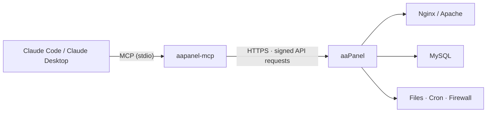

<p align="center">
  
</p>

<p align="center">
  <a href="https://github.com/dhtoan/aapanel-mcp/actions/workflows/ci.yml"></a>
  <a href="LICENSE"></a>
  
  
  
  
</p>

<p align="center">
  <b>English</b> · <a href="README.vi.md">Tiếng Việt</a> · <a href="README.zh-CN.md">简体中文</a> · <a href="README.th.md">ภาษาไทย</a>
</p>

<p align="center">
  <a href="#-quick-start">Quick start</a> ·
  <a href="#-what-you-can-ask">Examples</a> ·
  <a href="#-tools">Tools</a> ·
  <a href="#%EF%B8%8F-security-model">Security</a> ·
  <a href="#%EF%B8%8F-configuration">Configuration</a> ·
  <a href="#-troubleshooting">Troubleshooting</a>
</p>

---

**aaPanel MCP Server** connects [Claude](https://claude.ai) to your [aaPanel](https://www.aapanel.com) server through the [Model Context Protocol](https://modelcontextprotocol.io). You can manage websites, files, MySQL, services, cron jobs and the firewall in plain language. If you allow it, Claude can also run shell commands.

It runs next to Claude over stdio and talks to the panel's official API. Your API key never leaves your machine in clear text.

## ✨ Highlights

- **51 tools** covering websites, files, MySQL, services, cron, firewall, shell, and a raw API escape hatch.
- **Read-only by default.** Write, shell and raw API access are separate opt-in levels.
- **Guard rails built in:**
  - destructive actions require an exact `confirm` value;
  - file access is limited to allowed folders;
  - the panel's own secrets are blocked.
- **One-command install** on the server, or through `npx` on any computer.
- **Chunked upload and download** for backups and large files.
- **Tested end to end** against a mock aaPanel that verifies request signatures exactly like the real panel.

## 🚀 Quick start

**1. Enable the API.** In **aaPanel → Settings → API interface**:
- turn the API on;
- copy the API key;
- add the IP that will call the panel to the whitelist. If Claude runs on the server itself, that IP is `127.0.0.1`.

**2. Install with one command.**

<table>
<tr>
<th>Claude Code on the aaPanel server (Linux)</th>
<th>Claude Code on your computer (Windows · macOS · Linux)</th>
</tr>
<tr>
<td valign="top">

```bash
curl -fsSL https://raw.githubusercontent.com/dhtoan/aapanel-mcp/main/install.sh | bash
```

The script:
- builds into `~/.aapanel-mcp`;
- detects the panel port;
- asks for the API key (hidden while you type) and permissions;
- registers the server with Claude Code.

</td>
<td valign="top">

```bash
claude mcp add aapanel --scope user \
  -e AAPANEL_URL=https://YOUR_SERVER_IP:PANEL_PORT \
  -e AAPANEL_API_KEY=YOUR_API_KEY \
  -e AAPANEL_INSECURE_TLS=1 \
  -- npx -y github:dhtoan/aapanel-mcp
```

Requires Node.js 20+. Add `-e AAPANEL_ALLOW_WRITE=1` to allow changes.

</td>
</tr>
</table>

**3. Ask Claude.** Start a new Claude Code session and ask *"How is my server doing?"*

## 💬 What you can ask

> *"Show CPU, memory and disk usage, and tell me if anything looks wrong."*
>
> *"Create a site for shop.example.com on PHP 8.2 with a MySQL database."*
>
> *"Back up example.com and its database, then download both backups to my Downloads folder."*
>
> *"The site returns 502 — read the nginx error log and php-fpm status and find the cause."*
>
> *"Upload `./build.zip` to /www/wwwroot/example.com and extract it."*
>
> *"Open port 8080 and add a daily 3 AM cron job that clears old cache files."*

## 🧰 Tools

| Area | Read-only · always on | Write · `AAPANEL_ALLOW_WRITE=1` |
|---|---|---|
| 🖥️ **System** | `system_status` `panel_logs` `aapanel_permissions` | `service_control` (nginx, mysqld, php-fpm-XX, redis…) |
| 🌐 **Websites** | `list_sites` `list_site_domains` `site_logs` `list_php_versions` `get_site_php_version` `list_backups` | `create_site` `set_site_running` `add_site_domains` `remove_site_domain` `set_site_php_version` `set_force_https` `backup_site` `delete_site`⚠️ |
| 📁 **Files** | `list_dir` `read_file` `path_size` `download_file` | `write_file` `create_dir` `move_path` `copy_path` `compress` `extract` `set_permissions` `upload_file` `fetch_url_to_server` `delete_path`⚠️ |
| 🗄️ **MySQL** | `list_databases` (passwords masked) `mysql_info` | `create_database` `backup_database` `import_sql` `set_database_password` `delete_database`⚠️ |
| ⏰ **Cron** | `list_cron_jobs` `cron_job_log` | `run_cron_job` `toggle_cron_job` `delete_cron_job`⚠️ |
| 🔥 **Firewall** | `list_firewall_rules` | `open_port` `block_ip` `remove_firewall_rule`⚠️ |

| Opt-in level | Tools |
|---|---|
| 🐚 **Shell** · `AAPANEL_ALLOW_SHELL=1` | `run_command`: runs bash as root and returns output and exit code. `add_cron_shell_job`: creates a scheduled shell script. |
| 🔌 **Raw API** · `AAPANEL_ALLOW_RAW=1` | `api_call`: calls any panel action (SSL, redirects, proxies, PHP config…). |

⚠️ Destructive tools only run when `confirm` exactly matches the site, database, path, port or IP being removed.

## 🛡️ Security model

| Layer | Protection |
|---|---|
| **Permissions** | Read-only by default. Write, shell and raw API tools only appear when you enable them. |
| **Confirmation** | Delete tools require `confirm` to match the target exactly. Top-level folders such as `/www/wwwroot` cannot be deleted. |
| **Server paths** | File tools are limited to `AAPANEL_PATHS` (default `/www`). Paths with `..` are rejected. Panel internals (`/www/server/panel`, which holds the API key and panel database) are blocked, except `vhost` configs. |
| **Local paths** | Uploads only read from, and downloads only write to, `AAPANEL_LOCAL_DIRS`. |
| **API key** | Never sent in clear. Each request carries `request_token = md5(request_time + md5(key))`. |
| **Secrets in output** | Stored database passwords are masked as `••••`. |

> [!WARNING]
> `run_command` runs as **root** and is **not** limited by `AAPANEL_PATHS`. Only enable `AAPANEL_ALLOW_SHELL` if you read every command before approving it.

## 🏗️ How it works



## ⚙️ Configuration

| Variable | Default | Description |
|---|---|---|
| `AAPANEL_URL` | **required** | Panel origin, e.g. `https://1.2.3.4:8888`. Do not include the security entry path. |
| `AAPANEL_API_KEY` | **required** | API key from Settings → API interface. |
| `AAPANEL_INSECURE_TLS` | `0` | Set to `1` if the panel uses a self-signed certificate. Applies only to panel requests. |
| `AAPANEL_ALLOW_WRITE` | `0` | Enable tools that change data. |
| `AAPANEL_ALLOW_SHELL` | `0` | Enable `run_command` and `add_cron_shell_job` (run as root). |
| `AAPANEL_ALLOW_RAW` | `0` | Enable `api_call`. |
| `AAPANEL_PATHS` | `/www` | Server folders the file tools may use, comma-separated. |
| `AAPANEL_LOCAL_DIRS` | current folder | Local folders used for uploads and downloads. |
| `AAPANEL_TIMEOUT_MS` | `60000` | Maximum wait per request. |

<details>
<summary><b>📦 Manual install</b></summary>

<br>

```bash
git clone https://github.com/dhtoan/aapanel-mcp.git
cd aapanel-mcp
npm install
npm test
```

`npm install` also builds the server. `npm test` runs every tool against a mock panel.

Register it with Claude Code:

```bash
claude mcp add aapanel --scope user \
  -e AAPANEL_URL=https://your-server-ip:8888 \
  -e AAPANEL_API_KEY=<API_KEY> \
  -e AAPANEL_INSECURE_TLS=1 \
  -e AAPANEL_ALLOW_WRITE=1 \
  -e AAPANEL_LOCAL_DIRS=/path/to/local/folder \
  -- node /path/to/aapanel-mcp/dist/index.js
```

</details>

<details>
<summary><b>🖥️ Claude Desktop</b></summary>

<br>

Add this to `claude_desktop_config.json`:

```json
{
  "mcpServers": {
    "aapanel": {
      "command": "npx",
      "args": ["-y", "github:dhtoan/aapanel-mcp"],
      "env": {
        "AAPANEL_URL": "https://your-server-ip:8888",
        "AAPANEL_API_KEY": "<API_KEY>",
        "AAPANEL_INSECURE_TLS": "1",
        "AAPANEL_ALLOW_WRITE": "1"
      }
    }
  }
}
```

</details>

## 🩺 Troubleshooting

<details>
<summary><b>"The panel returned an HTML page instead of JSON"</b></summary>

<br>

This means the API is off, the key is wrong, or the calling IP is not whitelisted. Check **Settings → API interface**, and make sure your current public IP is in the list (see https://ifconfig.me). Home IPs change often.

</details>

<details>
<summary><b>TLS / certificate error</b></summary>

<br>

The panel uses a self-signed certificate. Set `AAPANEL_INSECURE_TLS=1`. This relaxes certificate checks only for requests to the panel.

</details>

<details>
<summary><b>"20 consecutive verification failures, prohibited for 1 hour"</b></summary>

<br>

The panel blocked your IP after repeated wrong tokens. Fix the key or whitelist, then wait an hour, or restart the panel.

</details>

<details>
<summary><b>An action fails with an unexpected panel message</b></summary>

<br>

Action names come from the aaPanel source code and the official aaPanel MCP server, but some actions vary between panel versions. The tool returns the panel's own message. Please [open an issue](https://github.com/dhtoan/aapanel-mcp/issues) with your panel version.

</details>

## 🧪 Development

```bash
npm install
npm test
```

`npm test` builds the server and runs 37 end-to-end checks against a mock aaPanel. The mock verifies request signatures, path guards, confirmations, chunked upload/download and shell exit codes. CI runs the checks on Node.js 20, 22 and 24.

Project layout:
- `src/client.ts`: signed API client.
- `src/guard.ts`: path and confirmation guards.
- `src/tools/*`: one module per area.

## 🤝 Contributing

Issues and pull requests are welcome. If a panel action behaves differently on your aaPanel version, please include the version and the panel's response.

## 📄 License

[MIT](LICENSE). Not affiliated with aaPanel or Anthropic.
