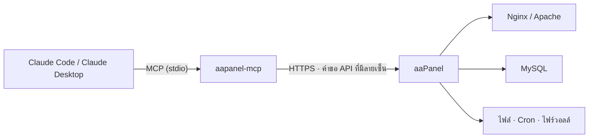

<p align="center">
  
</p>

<p align="center">
  <a href="https://github.com/dhtoan/aapanel-mcp/actions/workflows/ci.yml"></a>
  <a href="LICENSE"></a>
  
  
  
  
</p>

<p align="center">
  <a href="README.md">English</a> · <a href="README.vi.md">Tiếng Việt</a> · <a href="README.zh-CN.md">简体中文</a> · <b>ภาษาไทย</b>
</p>

---

**aaPanel MCP Server** เชื่อมต่อ [Claude](https://claude.ai) เข้ากับเซิร์ฟเวอร์ [aaPanel](https://www.aapanel.com) ของคุณผ่าน [Model Context Protocol](https://modelcontextprotocol.io) คุณจัดการเว็บไซต์ ไฟล์ MySQL บริการ งานตามกำหนดเวลา (cron) และไฟร์วอลล์ได้ด้วยภาษาธรรมดา หากคุณอนุญาต Claude ยังรันคำสั่ง shell ได้ด้วย

เซิร์ฟเวอร์นี้ทำงานบนเครื่องเดียวกับ Claude ผ่าน stdio และใช้ API อย่างเป็นทางการของแผงควบคุม API key จะไม่ถูกส่งออกจากเครื่องของคุณในรูปข้อความธรรมดา

## ✨ จุดเด่น

- **เครื่องมือ 51 รายการ** ครอบคลุมเว็บไซต์ ไฟล์ MySQL บริการ cron ไฟร์วอลล์ และ shell พร้อมช่องทางเรียก API โดยตรงสำหรับกรณีอื่น ๆ
- **ค่าเริ่มต้นเป็นแบบอ่านอย่างเดียว** สิทธิ์เขียน shell และ API โดยตรงแยกเป็นสามระดับ และต้องเปิดเองเท่านั้น
- **มีระบบป้องกันในตัว:**
  - การลบต้องระบุค่า `confirm` ให้ตรงทุกตัวอักษร
  - การเข้าถึงไฟล์จำกัดเฉพาะโฟลเดอร์ที่อนุญาต
  - ไฟล์ลับของแผงควบคุมถูกบล็อก
- **ติดตั้งด้วยคำสั่งเดียว** บนเซิร์ฟเวอร์ หรือผ่าน `npx` บนคอมพิวเตอร์เครื่องใดก็ได้
- **อัปโหลดและดาวน์โหลดแบบแบ่งส่วน** ใช้กับไฟล์สำรองข้อมูลและไฟล์ขนาดใหญ่ได้
- **ทดสอบแบบครบวงจร** กับ aaPanel จำลองที่ตรวจลายเซ็นคำขอเหมือนแผงควบคุมจริงทุกประการ

## 🚀 เริ่มต้นอย่างรวดเร็ว

**1. เปิดใช้ API** ไปที่ **aaPanel → Settings → API interface**:
- เปิด API
- คัดลอก API key
- เพิ่ม IP ที่จะเรียกแผงควบคุมลงในรายการที่อนุญาต (whitelist) หาก Claude ทำงานบนเซิร์ฟเวอร์นั้นเอง IP นั้นคือ `127.0.0.1`

**2. ติดตั้งด้วยคำสั่งเดียว**

<table>
<tr>
<th>Claude Code ทำงานบนเซิร์ฟเวอร์ aaPanel (Linux)</th>
<th>Claude Code ทำงานบนคอมพิวเตอร์ของคุณ (Windows · macOS · Linux)</th>
</tr>
<tr>
<td valign="top">

```bash
curl -fsSL https://raw.githubusercontent.com/dhtoan/aapanel-mcp/main/install.sh | bash
```

สคริปต์จะ:
- build ไว้ที่ `~/.aapanel-mcp`
- ตรวจหาพอร์ตของแผงควบคุมอัตโนมัติ
- ถาม API key (ไม่แสดงขณะพิมพ์) และสิทธิ์ที่ต้องการ
- ลงทะเบียนกับ Claude Code

</td>
<td valign="top">

```bash
claude mcp add aapanel --scope user \
  -e AAPANEL_URL=https://YOUR_SERVER_IP:PANEL_PORT \
  -e AAPANEL_API_KEY=YOUR_API_KEY \
  -e AAPANEL_INSECURE_TLS=1 \
  -- npx -y github:dhtoan/aapanel-mcp
```

ต้องใช้ Node.js 20 ขึ้นไป เพิ่ม `-e AAPANEL_ALLOW_WRITE=1` เพื่ออนุญาตให้แก้ไขข้อมูล

</td>
</tr>
</table>

**3. ถาม Claude** เปิดเซสชัน Claude Code ใหม่แล้วถามว่า *"เซิร์ฟเวอร์ของฉันเป็นอย่างไรบ้าง?"*

## 💬 ตัวอย่างคำถาม

> *"แสดงการใช้ CPU หน่วยความจำ และดิสก์ แล้วบอกว่ามีอะไรผิดปกติไหม"*
>
> *"สร้างเว็บไซต์ shop.example.com ที่ใช้ PHP 8.2 พร้อมฐานข้อมูล MySQL"*
>
> *"สำรองข้อมูล example.com และฐานข้อมูลของมัน แล้วดาวน์โหลดไฟล์สำรองทั้งสองมาไว้ในโฟลเดอร์ Downloads ของฉัน"*
>
> *"เว็บไซต์แสดงข้อผิดพลาด 502 ช่วยอ่าน error log ของ nginx และสถานะ php-fpm แล้วหาสาเหตุ"*
>
> *"อัปโหลด `./build.zip` ไปที่ /www/wwwroot/example.com แล้วแตกไฟล์"*
>
> *"เปิดพอร์ต 8080 และเพิ่มงาน cron ที่ล้างไฟล์แคชเก่าทุกวันเวลาตีสาม"*

## 🧰 เครื่องมือ

| หมวด | อ่านอย่างเดียว · เปิดเสมอ | เขียน · `AAPANEL_ALLOW_WRITE=1` |
|---|---|---|
| 🖥️ **ระบบ** | `system_status` `panel_logs` `aapanel_permissions` | `service_control` (nginx, mysqld, php-fpm-XX, redis…) |
| 🌐 **เว็บไซต์** | `list_sites` `list_site_domains` `site_logs` `list_php_versions` `get_site_php_version` `list_backups` | `create_site` `set_site_running` `add_site_domains` `remove_site_domain` `set_site_php_version` `set_force_https` `backup_site` `delete_site`⚠️ |
| 📁 **ไฟล์** | `list_dir` `read_file` `path_size` `download_file` | `write_file` `create_dir` `move_path` `copy_path` `compress` `extract` `set_permissions` `upload_file` `fetch_url_to_server` `delete_path`⚠️ |
| 🗄️ **MySQL** | `list_databases` (ซ่อนรหัสผ่าน) `mysql_info` | `create_database` `backup_database` `import_sql` `set_database_password` `delete_database`⚠️ |
| ⏰ **Cron** | `list_cron_jobs` `cron_job_log` | `run_cron_job` `toggle_cron_job` `delete_cron_job`⚠️ |
| 🔥 **ไฟร์วอลล์** | `list_firewall_rules` | `open_port` `block_ip` `remove_firewall_rule`⚠️ |

| ระดับที่ต้องเปิดเอง | เครื่องมือ |
|---|---|
| 🐚 **Shell** · `AAPANEL_ALLOW_SHELL=1` | `run_command`: รันคำสั่ง bash ด้วยสิทธิ์ root และส่งคืนผลลัพธ์พร้อม exit code `add_cron_shell_job`: สร้างงาน cron ที่รันสคริปต์ shell |
| 🔌 **API โดยตรง** · `AAPANEL_ALLOW_RAW=1` | `api_call`: เรียก action ใดก็ได้ของแผงควบคุม (SSL, redirect, proxy, การตั้งค่า PHP…) |

⚠️ เครื่องมือที่ลบข้อมูลจะทำงานก็ต่อเมื่อ `confirm` ตรงกับชื่อเว็บไซต์ ฐานข้อมูล พาธ พอร์ต หรือ IP ที่จะลบทุกตัวอักษร

## 🛡️ โมเดลความปลอดภัย

| ชั้น | การป้องกัน |
|---|---|
| **สิทธิ์** | ค่าเริ่มต้นเป็นอ่านอย่างเดียว เครื่องมือเขียน shell และ API โดยตรงจะปรากฏเมื่อคุณเปิดใช้เท่านั้น |
| **การยืนยัน** | เครื่องมือลบต้องมี `confirm` ตรงกับเป้าหมายทุกตัวอักษร และลบโฟลเดอร์ระดับบนอย่าง `/www/wwwroot` ไม่ได้ |
| **พาธบนเซิร์ฟเวอร์** | เครื่องมือไฟล์ทำงานได้เฉพาะใน `AAPANEL_PATHS` (ค่าเริ่มต้น `/www`) พาธที่มี `..` จะถูกปฏิเสธ ไฟล์ภายในของแผงควบคุม (`/www/server/panel` ซึ่งเก็บ API key และฐานข้อมูลของแผงควบคุม) ถูกบล็อก ยกเว้นโฟลเดอร์การตั้งค่า `vhost` |
| **พาธบนเครื่องของคุณ** | การอัปโหลดอ่านไฟล์ และการดาวน์โหลดเขียนไฟล์ ได้เฉพาะใน `AAPANEL_LOCAL_DIRS` |
| **API key** | ไม่ถูกส่งเป็นข้อความธรรมดา ทุกคำขอส่งเพียง `request_token = md5(request_time + md5(key))` |
| **ข้อมูลลับในผลลัพธ์** | รหัสผ่านฐานข้อมูลที่บันทึกไว้จะแสดงเป็น `••••` |

> [!WARNING]
> `run_command` ทำงานด้วยสิทธิ์ **root** และ **ไม่** ถูกจำกัดโดย `AAPANEL_PATHS` เปิด `AAPANEL_ALLOW_SHELL` เฉพาะเมื่อคุณอ่านทุกคำสั่งก่อนอนุมัติเท่านั้น

## 🏗️ หลักการทำงาน



## ⚙️ การตั้งค่า

| ตัวแปร | ค่าเริ่มต้น | คำอธิบาย |
|---|---|---|
| `AAPANEL_URL` | **จำเป็น** | ที่อยู่ของแผงควบคุม เช่น `https://1.2.3.4:8888` ห้ามใส่พาธทางเข้าความปลอดภัย (security entry) |
| `AAPANEL_API_KEY` | **จำเป็น** | API key จาก Settings → API interface |
| `AAPANEL_INSECURE_TLS` | `0` | ตั้งเป็น `1` หากแผงควบคุมใช้ใบรับรองแบบ self-signed มีผลเฉพาะคำขอไปยังแผงควบคุม |
| `AAPANEL_ALLOW_WRITE` | `0` | เปิดเครื่องมือที่แก้ไขข้อมูล |
| `AAPANEL_ALLOW_SHELL` | `0` | เปิด `run_command` และ `add_cron_shell_job` (ทำงานด้วยสิทธิ์ root) |
| `AAPANEL_ALLOW_RAW` | `0` | เปิด `api_call` |
| `AAPANEL_PATHS` | `/www` | โฟลเดอร์บนเซิร์ฟเวอร์ที่เครื่องมือไฟล์ใช้ได้ คั่นด้วยเครื่องหมายจุลภาค |
| `AAPANEL_LOCAL_DIRS` | โฟลเดอร์ปัจจุบัน | โฟลเดอร์บนเครื่องของคุณที่ใช้สำหรับอัปโหลดและดาวน์โหลด |
| `AAPANEL_TIMEOUT_MS` | `60000` | เวลารอสูงสุดต่อคำขอ |

<details>
<summary><b>📦 ติดตั้งเอง</b></summary>

<br>

```bash
git clone https://github.com/dhtoan/aapanel-mcp.git
cd aapanel-mcp
npm install
npm test
```

`npm install` จะ build เซิร์ฟเวอร์ให้ด้วย `npm test` จะทดสอบเครื่องมือทั้งหมดกับแผงควบคุมจำลอง

ลงทะเบียนกับ Claude Code:

```bash
claude mcp add aapanel --scope user \
  -e AAPANEL_URL=https://your-server-ip:8888 \
  -e AAPANEL_API_KEY=<API_KEY> \
  -e AAPANEL_INSECURE_TLS=1 \
  -e AAPANEL_ALLOW_WRITE=1 \
  -e AAPANEL_LOCAL_DIRS=/path/to/local/folder \
  -- node /path/to/aapanel-mcp/dist/index.js
```

</details>

<details>
<summary><b>🖥️ Claude Desktop</b></summary>

<br>

เพิ่มส่วนนี้ลงใน `claude_desktop_config.json`:

```json
{
  "mcpServers": {
    "aapanel": {
      "command": "npx",
      "args": ["-y", "github:dhtoan/aapanel-mcp"],
      "env": {
        "AAPANEL_URL": "https://your-server-ip:8888",
        "AAPANEL_API_KEY": "<API_KEY>",
        "AAPANEL_INSECURE_TLS": "1",
        "AAPANEL_ALLOW_WRITE": "1"
      }
    }
  }
}
```

</details>

## 🩺 การแก้ไขปัญหา

<details>
<summary><b>"The panel returned an HTML page instead of JSON"</b></summary>

<br>

ข้อความนี้หมายความว่า API ปิดอยู่ คีย์ไม่ถูกต้อง หรือ IP ที่เรียกไม่อยู่ใน whitelist ให้ตรวจสอบ **Settings → API interface** และตรวจว่า IP สาธารณะปัจจุบันของคุณอยู่ในรายการ (ดูได้ที่ https://ifconfig.me) IP ของอินเทอร์เน็ตบ้านมักเปลี่ยนบ่อย

</details>

<details>
<summary><b>ข้อผิดพลาด TLS / ใบรับรอง</b></summary>

<br>

แผงควบคุมใช้ใบรับรองแบบ self-signed ให้ตั้ง `AAPANEL_INSECURE_TLS=1` การตั้งค่านี้ผ่อนการตรวจใบรับรองเฉพาะคำขอที่ส่งไปยังแผงควบคุม

</details>

<details>
<summary><b>"20 consecutive verification failures, prohibited for 1 hour"</b></summary>

<br>

แผงควบคุมบล็อก IP ของคุณหลังจากโทเค็นผิดหลายครั้ง ให้แก้ไขคีย์หรือ whitelist แล้วรอหนึ่งชั่วโมง หรือรีสตาร์ตแผงควบคุม

</details>

<details>
<summary><b>action บางรายการแสดงข้อความที่ไม่คาดคิดจากแผงควบคุม</b></summary>

<br>

ชื่อ action มาจากซอร์สโค้ดของ aaPanel และ MCP server อย่างเป็นทางการของ aaPanel แต่บาง action อาจต่างกันในแต่ละเวอร์ชันของแผงควบคุม เครื่องมือจะส่งคืนข้อความจากแผงควบคุมตามจริง โปรด[เปิด issue](https://github.com/dhtoan/aapanel-mcp/issues) พร้อมระบุเวอร์ชันของแผงควบคุม

</details>

## 🧪 การพัฒนา

```bash
npm install
npm test
```

`npm test` จะ build เซิร์ฟเวอร์แล้วรันการตรวจสอบแบบครบวงจร 37 รายการกับ aaPanel จำลอง ซึ่งตรวจลายเซ็นคำขอ การป้องกันพาธ การยืนยันก่อนลบ การอัปโหลด/ดาวน์โหลดแบบแบ่งส่วน และ exit code ของคำสั่ง shell CI รันการตรวจสอบเหล่านี้บน Node.js 20, 22 และ 24

โครงสร้างโปรเจกต์:
- `src/client.ts`: ไคลเอนต์ API ที่ลงลายเซ็นคำขอ
- `src/guard.ts`: การป้องกันพาธและการยืนยันก่อนลบ
- `src/tools/*`: หนึ่งโมดูลต่อหนึ่งหมวด

## 🤝 การมีส่วนร่วม

ยินดีรับ issue และ pull request หาก action ใดทำงานต่างไปในเวอร์ชัน aaPanel ของคุณ โปรดแนบเวอร์ชันและข้อความตอบกลับจากแผงควบคุม

## 📄 สัญญาอนุญาต

[MIT](LICENSE) โปรเจกต์นี้ไม่มีส่วนเกี่ยวข้องกับ aaPanel หรือ Anthropic
