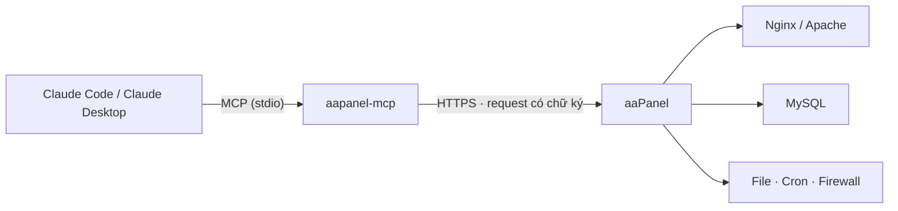

<p align="center">
  
</p>

<p align="center">
  <a href="https://github.com/dhtoan/aapanel-mcp/actions/workflows/ci.yml"></a>
  <a href="LICENSE"></a>
  
  
  
  
</p>

<p align="center">
  <a href="README.md">English</a> · <b>Tiếng Việt</b> · <a href="README.zh-CN.md">简体中文</a> · <a href="README.th.md">ภาษาไทย</a>
</p>

---

**aaPanel MCP Server** kết nối [Claude](https://claude.ai) với server [aaPanel](https://www.aapanel.com) của bạn qua [Model Context Protocol](https://modelcontextprotocol.io). Bạn quản lý website, file, MySQL, dịch vụ, cron và firewall bằng ngôn ngữ thường. Nếu bạn cho phép, Claude còn chạy được lệnh shell.

Server chạy cùng máy với Claude qua stdio và dùng API chính thức của panel. API key không bao giờ rời khỏi máy bạn ở dạng nguyên văn.

## ✨ Điểm nổi bật

- **51 công cụ** cho website, file, MySQL, dịch vụ, cron, firewall, shell, kèm lối gọi API thô cho các trường hợp còn lại.
- **Mặc định chỉ đọc.** Quyền ghi, shell và API thô là ba mức riêng, chỉ bật khi bạn chọn.
- **Có sẵn lớp bảo vệ:**
  - thao tác xóa bắt buộc gõ đúng giá trị `confirm`;
  - truy cập file chỉ trong các thư mục cho phép;
  - file bí mật của panel bị chặn.
- **Cài bằng một lệnh** trên server, hoặc qua `npx` trên bất kỳ máy tính nào.
- **Upload và download theo từng phần**, dùng được cho file backup và file lớn.
- **Kiểm thử đầu-cuối** trên một aaPanel giả lập, kiểm chữ ký request giống hệt panel thật.

## 🚀 Bắt đầu nhanh

**1. Bật API.** Vào **aaPanel → Settings → API interface**:
- bật API;
- copy API key;
- thêm IP sẽ gọi panel vào whitelist. Nếu Claude chạy ngay trên server thì IP đó là `127.0.0.1`.

**2. Cài bằng một lệnh.**

<table>
<tr>
<th>Claude Code chạy trên server aaPanel (Linux)</th>
<th>Claude Code chạy trên máy tính (Windows · macOS · Linux)</th>
</tr>
<tr>
<td valign="top">

```bash
curl -fsSL https://raw.githubusercontent.com/dhtoan/aapanel-mcp/main/install.sh | bash
```

Script sẽ:
- build vào `~/.aapanel-mcp`;
- tự dò cổng của panel;
- hỏi API key (không hiện khi gõ) và các quyền;
- đăng ký server với Claude Code.

</td>
<td valign="top">

```bash
claude mcp add aapanel --scope user \
  -e AAPANEL_URL=https://YOUR_SERVER_IP:PANEL_PORT \
  -e AAPANEL_API_KEY=YOUR_API_KEY \
  -e AAPANEL_INSECURE_TLS=1 \
  -- npx -y github:dhtoan/aapanel-mcp
```

Cần Node.js 20+. Thêm `-e AAPANEL_ALLOW_WRITE=1` để cho phép thay đổi dữ liệu.

</td>
</tr>
</table>

**3. Hỏi Claude.** Mở phiên Claude Code mới và hỏi *"Server của tôi đang thế nào?"*

## 💬 Bạn có thể hỏi gì

> *"Cho tôi xem CPU, RAM, ổ đĩa và cho biết có gì bất thường không."*
>
> *"Tạo site shop.example.com chạy PHP 8.2, kèm một database MySQL."*
>
> *"Backup example.com và database của nó, rồi tải cả hai bản backup về thư mục Downloads của tôi."*
>
> *"Site đang báo lỗi 502, đọc log lỗi nginx và trạng thái php-fpm rồi tìm nguyên nhân."*
>
> *"Upload `./build.zip` lên /www/wwwroot/example.com rồi giải nén."*
>
> *"Mở cổng 8080 và thêm cron chạy lúc 3 giờ sáng hằng ngày để dọn file cache cũ."*

## 🧰 Công cụ

| Nhóm | Chỉ đọc · luôn bật | Ghi · `AAPANEL_ALLOW_WRITE=1` |
|---|---|---|
| 🖥️ **Hệ thống** | `system_status` `panel_logs` `aapanel_permissions` | `service_control` (nginx, mysqld, php-fpm-XX, redis…) |
| 🌐 **Website** | `list_sites` `list_site_domains` `site_logs` `list_php_versions` `get_site_php_version` `list_backups` | `create_site` `set_site_running` `add_site_domains` `remove_site_domain` `set_site_php_version` `set_force_https` `backup_site` `delete_site`⚠️ |
| 📁 **File** | `list_dir` `read_file` `path_size` `download_file` | `write_file` `create_dir` `move_path` `copy_path` `compress` `extract` `set_permissions` `upload_file` `fetch_url_to_server` `delete_path`⚠️ |
| 🗄️ **MySQL** | `list_databases` (ẩn mật khẩu) `mysql_info` | `create_database` `backup_database` `import_sql` `set_database_password` `delete_database`⚠️ |
| ⏰ **Cron** | `list_cron_jobs` `cron_job_log` | `run_cron_job` `toggle_cron_job` `delete_cron_job`⚠️ |
| 🔥 **Firewall** | `list_firewall_rules` | `open_port` `block_ip` `remove_firewall_rule`⚠️ |

| Mức bật thêm | Công cụ |
|---|---|
| 🐚 **Shell** · `AAPANEL_ALLOW_SHELL=1` | `run_command`: chạy bash với quyền root, trả về output và exit code. `add_cron_shell_job`: tạo cron chạy script shell. |
| 🔌 **API thô** · `AAPANEL_ALLOW_RAW=1` | `api_call`: gọi bất kỳ action nào của panel (SSL, redirect, proxy, cấu hình PHP…). |

⚠️ Công cụ xóa chỉ chạy khi `confirm` đúng bằng tên site, database, đường dẫn, port hoặc IP cần xóa.

## 🛡️ Mô hình bảo mật

| Lớp | Bảo vệ |
|---|---|
| **Phân quyền** | Mặc định chỉ đọc. Công cụ ghi, shell và API thô chỉ xuất hiện khi bạn bật. |
| **Xác nhận** | Công cụ xóa bắt buộc `confirm` khớp chính xác với mục tiêu. Không xóa được thư mục cấp cao như `/www/wwwroot`. |
| **Đường dẫn trên server** | Công cụ file chỉ làm việc trong `AAPANEL_PATHS` (mặc định `/www`). Đường dẫn có `..` bị từ chối. File nội bộ của panel (`/www/server/panel`, nơi lưu API key và database của panel) bị chặn, trừ thư mục cấu hình `vhost`. |
| **Đường dẫn trên máy bạn** | Upload chỉ đọc file, và download chỉ ghi file, trong `AAPANEL_LOCAL_DIRS`. |
| **API key** | Không bao giờ gửi nguyên văn. Mỗi request chỉ mang `request_token = md5(request_time + md5(key))`. |
| **Bí mật trong kết quả** | Mật khẩu database đã lưu được hiển thị là `••••`. |

> [!WARNING]
> `run_command` chạy với quyền **root** và **không** bị giới hạn bởi `AAPANEL_PATHS`. Chỉ bật `AAPANEL_ALLOW_SHELL` khi bạn đọc kỹ từng lệnh trước khi duyệt.

## 🏗️ Cách hoạt động



## ⚙️ Cấu hình

| Biến | Mặc định | Mô tả |
|---|---|---|
| `AAPANEL_URL` | **bắt buộc** | Địa chỉ gốc của panel, ví dụ `https://1.2.3.4:8888`. Không thêm đường dẫn bảo mật. |
| `AAPANEL_API_KEY` | **bắt buộc** | API key lấy từ Settings → API interface. |
| `AAPANEL_INSECURE_TLS` | `0` | Đặt `1` khi panel dùng chứng chỉ tự ký. Chỉ áp dụng cho kết nối tới panel. |
| `AAPANEL_ALLOW_WRITE` | `0` | Bật các công cụ thay đổi dữ liệu. |
| `AAPANEL_ALLOW_SHELL` | `0` | Bật `run_command` và `add_cron_shell_job` (chạy với quyền root). |
| `AAPANEL_ALLOW_RAW` | `0` | Bật `api_call`. |
| `AAPANEL_PATHS` | `/www` | Các thư mục trên server mà công cụ file được dùng, phân cách bằng dấu phẩy. |
| `AAPANEL_LOCAL_DIRS` | thư mục hiện tại | Các thư mục trên máy bạn dùng cho upload và download. |
| `AAPANEL_TIMEOUT_MS` | `60000` | Thời gian chờ tối đa cho mỗi request. |

<details>
<summary><b>📦 Cài đặt thủ công</b></summary>

<br>

```bash
git clone https://github.com/dhtoan/aapanel-mcp.git
cd aapanel-mcp
npm install
npm test
```

`npm install` sẽ build luôn server. `npm test` chạy thử mọi công cụ trên panel giả lập.

Đăng ký với Claude Code:

```bash
claude mcp add aapanel --scope user \
  -e AAPANEL_URL=https://your-server-ip:8888 \
  -e AAPANEL_API_KEY=<API_KEY> \
  -e AAPANEL_INSECURE_TLS=1 \
  -e AAPANEL_ALLOW_WRITE=1 \
  -e AAPANEL_LOCAL_DIRS=/path/to/local/folder \
  -- node /path/to/aapanel-mcp/dist/index.js
```

</details>

<details>
<summary><b>🖥️ Claude Desktop</b></summary>

<br>

Thêm đoạn sau vào `claude_desktop_config.json`:

```json
{
  "mcpServers": {
    "aapanel": {
      "command": "npx",
      "args": ["-y", "github:dhtoan/aapanel-mcp"],
      "env": {
        "AAPANEL_URL": "https://your-server-ip:8888",
        "AAPANEL_API_KEY": "<API_KEY>",
        "AAPANEL_INSECURE_TLS": "1",
        "AAPANEL_ALLOW_WRITE": "1"
      }
    }
  }
}
```

</details>

## 🩺 Xử lý sự cố

<details>
<summary><b>"The panel returned an HTML page instead of JSON"</b></summary>

<br>

Lỗi này nghĩa là API đang tắt, key sai, hoặc IP gọi tới chưa có trong whitelist. Kiểm tra **Settings → API interface**, và chắc chắn IP công khai hiện tại của bạn có trong danh sách (xem tại https://ifconfig.me). IP nhà thường thay đổi.

</details>

<details>
<summary><b>Lỗi TLS / chứng chỉ</b></summary>

<br>

Panel đang dùng chứng chỉ tự ký. Đặt `AAPANEL_INSECURE_TLS=1`. Thiết lập này chỉ nới kiểm tra chứng chỉ cho các request gửi tới panel.

</details>

<details>
<summary><b>"20 consecutive verification failures, prohibited for 1 hour"</b></summary>

<br>

Panel đã khóa IP của bạn sau nhiều lần sai token. Sửa key hoặc whitelist, rồi chờ một giờ hoặc khởi động lại panel.

</details>

<details>
<summary><b>Một action báo lỗi lạ từ panel</b></summary>

<br>

Tên action được lấy từ mã nguồn aaPanel và MCP chính thức của aaPanel, nhưng một số action khác nhau giữa các phiên bản panel. Công cụ sẽ trả về đúng thông báo của panel. Hãy [tạo issue](https://github.com/dhtoan/aapanel-mcp/issues) kèm phiên bản panel của bạn.

</details>

## 🧪 Phát triển

```bash
npm install
npm test
```

`npm test` build server rồi chạy 37 kiểm tra đầu-cuối trên một aaPanel giả lập. Panel giả lập kiểm chữ ký request, lớp chặn đường dẫn, bước xác nhận, upload/download theo từng phần và exit code của lệnh shell. CI chạy các kiểm tra này trên Node.js 20, 22 và 24.

Cấu trúc dự án:
- `src/client.ts`: client gọi API có chữ ký.
- `src/guard.ts`: chặn đường dẫn và kiểm tra xác nhận.
- `src/tools/*`: mỗi nhóm công cụ một module.

## 🤝 Đóng góp

Rất hoan nghênh issue và pull request. Nếu một action chạy khác đi trên phiên bản aaPanel của bạn, hãy gửi kèm phiên bản và phản hồi của panel.

## 📄 Giấy phép

[MIT](LICENSE). Dự án không liên kết với aaPanel hay Anthropic.
