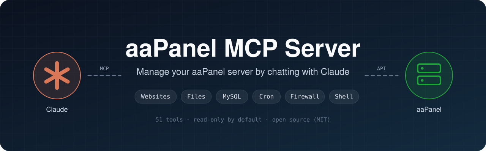
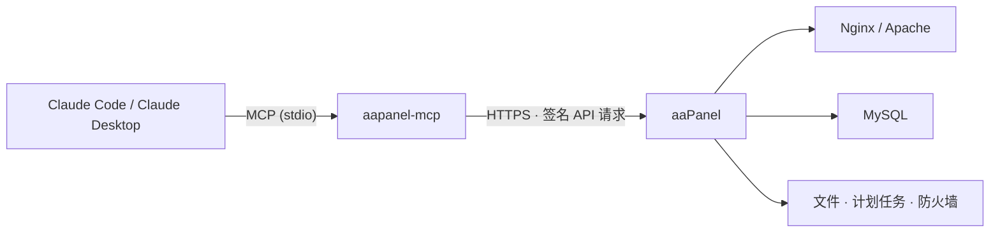

<p align="center">
  
</p>

<p align="center">
  <a href="https://github.com/dhtoan/aapanel-mcp/actions/workflows/ci.yml"></a>
  <a href="LICENSE"></a>
  
  
  
  
</p>

<p align="center">
  <a href="README.md">English</a> · <a href="README.vi.md">Tiếng Việt</a> · <b>简体中文</b> · <a href="README.th.md">ภาษาไทย</a>
</p>

---

**aaPanel MCP Server** 通过 [Model Context Protocol](https://modelcontextprotocol.io) 把 [Claude](https://claude.ai) 连接到你的 [aaPanel](https://www.aapanel.com) 服务器。你可以用自然语言管理网站、文件、MySQL、服务、计划任务和防火墙。在你允许的情况下，Claude 还可以执行 shell 命令。

它通过 stdio 与 Claude 运行在同一台机器上，并调用面板的官方 API。API 密钥从不以明文形式离开你的机器。

## ✨ 亮点

- **51 个工具**，覆盖网站、文件、MySQL、服务、计划任务、防火墙和 shell，另有可调用任意面板接口的原始 API。
- **默认只读。** 写入、shell 和原始 API 是三个独立的权限级别，需要你主动开启。
- **内置安全防护：**
  - 删除类操作必须提供完全一致的 `confirm` 值；
  - 文件操作仅限于允许的目录；
  - 面板自身的敏感文件被禁止访问。
- **一条命令安装**：可在服务器上安装，也可在任意电脑上通过 `npx` 运行。
- **分块上传和下载**，适用于备份文件和大文件。
- **端到端测试**：在模拟的 aaPanel 上运行，签名校验方式与真实面板完全相同。

## 🚀 快速开始

**1. 开启 API。** 进入 **aaPanel → Settings → API interface**：
- 开启 API；
- 复制 API 密钥；
- 把调用面板的 IP 加入白名单。如果 Claude 就运行在这台服务器上，该 IP 为 `127.0.0.1`。

**2. 一条命令安装。**

<table>
<tr>
<th>Claude Code 运行在 aaPanel 服务器上（Linux）</th>
<th>Claude Code 运行在你的电脑上（Windows · macOS · Linux）</th>
</tr>
<tr>
<td valign="top">

```bash
curl -fsSL https://raw.githubusercontent.com/dhtoan/aapanel-mcp/main/install.sh | bash
```

脚本会：
- 构建到 `~/.aapanel-mcp`；
- 自动检测面板端口；
- 询问 API 密钥（输入时不显示）和权限；
- 在 Claude Code 中注册。

</td>
<td valign="top">

```bash
claude mcp add aapanel --scope user \
  -e AAPANEL_URL=https://YOUR_SERVER_IP:PANEL_PORT \
  -e AAPANEL_API_KEY=YOUR_API_KEY \
  -e AAPANEL_INSECURE_TLS=1 \
  -- npx -y github:dhtoan/aapanel-mcp
```

需要 Node.js 20+。添加 `-e AAPANEL_ALLOW_WRITE=1` 可允许修改数据。

</td>
</tr>
</table>

**3. 向 Claude 提问。** 打开新的 Claude Code 会话，问一句 *“我的服务器状态怎么样？”*

## 💬 你可以这样问

> *“显示 CPU、内存和磁盘使用情况，并告诉我有没有异常。”*
>
> *“为 shop.example.com 创建一个使用 PHP 8.2 的网站，并创建 MySQL 数据库。”*
>
> *“备份 example.com 及其数据库，然后把两个备份都下载到我的 Downloads 文件夹。”*
>
> *“网站返回 502，请查看 nginx 错误日志和 php-fpm 状态，找出原因。”*
>
> *“把 `./build.zip` 上传到 /www/wwwroot/example.com 并解压。”*
>
> *“开放 8080 端口，并添加一个每天凌晨 3 点清理旧缓存文件的计划任务。”*

## 🧰 工具

| 类别 | 只读 · 始终启用 | 写入 · `AAPANEL_ALLOW_WRITE=1` |
|---|---|---|
| 🖥️ **系统** | `system_status` `panel_logs` `aapanel_permissions` | `service_control`（nginx、mysqld、php-fpm-XX、redis…） |
| 🌐 **网站** | `list_sites` `list_site_domains` `site_logs` `list_php_versions` `get_site_php_version` `list_backups` | `create_site` `set_site_running` `add_site_domains` `remove_site_domain` `set_site_php_version` `set_force_https` `backup_site` `delete_site`⚠️ |
| 📁 **文件** | `list_dir` `read_file` `path_size` `download_file` | `write_file` `create_dir` `move_path` `copy_path` `compress` `extract` `set_permissions` `upload_file` `fetch_url_to_server` `delete_path`⚠️ |
| 🗄️ **MySQL** | `list_databases`（隐藏密码） `mysql_info` | `create_database` `backup_database` `import_sql` `set_database_password` `delete_database`⚠️ |
| ⏰ **计划任务** | `list_cron_jobs` `cron_job_log` | `run_cron_job` `toggle_cron_job` `delete_cron_job`⚠️ |
| 🔥 **防火墙** | `list_firewall_rules` | `open_port` `block_ip` `remove_firewall_rule`⚠️ |

| 可选级别 | 工具 |
|---|---|
| 🐚 **Shell** · `AAPANEL_ALLOW_SHELL=1` | `run_command`：以 root 身份执行 bash 命令，返回输出和退出码。`add_cron_shell_job`：创建运行 shell 脚本的计划任务。 |
| 🔌 **原始 API** · `AAPANEL_ALLOW_RAW=1` | `api_call`：调用任意面板接口（SSL、重定向、反向代理、PHP 配置等）。 |

⚠️ 删除类工具只有在 `confirm` 与要删除的网站、数据库、路径、端口或 IP 完全一致时才会执行。

## 🛡️ 安全模型

| 层级 | 防护措施 |
|---|---|
| **权限** | 默认只读。写入、shell 和原始 API 工具只有在你开启后才会出现。 |
| **确认** | 删除类工具要求 `confirm` 与目标完全一致。无法删除 `/www/wwwroot` 这类顶层目录。 |
| **服务器路径** | 文件工具仅限 `AAPANEL_PATHS`（默认 `/www`）。包含 `..` 的路径会被拒绝。面板内部文件（`/www/server/panel`，其中保存 API 密钥和面板数据库）被禁止访问，`vhost` 配置目录除外。 |
| **本地路径** | 上传只从 `AAPANEL_LOCAL_DIRS` 读取，下载只写入 `AAPANEL_LOCAL_DIRS`。 |
| **API 密钥** | 从不以明文发送。每个请求只携带 `request_token = md5(request_time + md5(key))`。 |
| **输出中的敏感信息** | 已保存的数据库密码显示为 `••••`。 |

> [!WARNING]
> `run_command` 以 **root** 身份运行，**不受** `AAPANEL_PATHS` 限制。请仅在你会逐条阅读并批准命令时开启 `AAPANEL_ALLOW_SHELL`。

## 🏗️ 工作原理



## ⚙️ 配置

| 变量 | 默认值 | 说明 |
|---|---|---|
| `AAPANEL_URL` | **必填** | 面板地址，例如 `https://1.2.3.4:8888`。不要包含安全入口路径。 |
| `AAPANEL_API_KEY` | **必填** | 在 Settings → API interface 中获取的 API 密钥。 |
| `AAPANEL_INSECURE_TLS` | `0` | 面板使用自签名证书时设为 `1`。仅作用于面板请求。 |
| `AAPANEL_ALLOW_WRITE` | `0` | 启用修改数据的工具。 |
| `AAPANEL_ALLOW_SHELL` | `0` | 启用 `run_command` 和 `add_cron_shell_job`（以 root 运行）。 |
| `AAPANEL_ALLOW_RAW` | `0` | 启用 `api_call`。 |
| `AAPANEL_PATHS` | `/www` | 文件工具可使用的服务器目录，用逗号分隔。 |
| `AAPANEL_LOCAL_DIRS` | 当前目录 | 用于上传和下载的本地目录。 |
| `AAPANEL_TIMEOUT_MS` | `60000` | 每个请求的最长等待时间。 |

<details>
<summary><b>📦 手动安装</b></summary>

<br>

```bash
git clone https://github.com/dhtoan/aapanel-mcp.git
cd aapanel-mcp
npm install
npm test
```

`npm install` 会同时构建服务器。`npm test` 会在模拟面板上测试全部工具。

在 Claude Code 中注册：

```bash
claude mcp add aapanel --scope user \
  -e AAPANEL_URL=https://your-server-ip:8888 \
  -e AAPANEL_API_KEY=<API_KEY> \
  -e AAPANEL_INSECURE_TLS=1 \
  -e AAPANEL_ALLOW_WRITE=1 \
  -e AAPANEL_LOCAL_DIRS=/path/to/local/folder \
  -- node /path/to/aapanel-mcp/dist/index.js
```

</details>

<details>
<summary><b>🖥️ Claude Desktop</b></summary>

<br>

在 `claude_desktop_config.json` 中添加：

```json
{
  "mcpServers": {
    "aapanel": {
      "command": "npx",
      "args": ["-y", "github:dhtoan/aapanel-mcp"],
      "env": {
        "AAPANEL_URL": "https://your-server-ip:8888",
        "AAPANEL_API_KEY": "<API_KEY>",
        "AAPANEL_INSECURE_TLS": "1",
        "AAPANEL_ALLOW_WRITE": "1"
      }
    }
  }
}
```

</details>

## 🩺 故障排除

<details>
<summary><b>"The panel returned an HTML page instead of JSON"</b></summary>

<br>

这表示 API 未开启、密钥错误，或调用方 IP 不在白名单中。请检查 **Settings → API interface**，并确认你当前的公网 IP 已在列表中（可在 https://ifconfig.me 查看）。家庭网络的 IP 经常变化。

</details>

<details>
<summary><b>TLS / 证书错误</b></summary>

<br>

面板使用的是自签名证书。请设置 `AAPANEL_INSECURE_TLS=1`。该设置只放宽对面板请求的证书校验。

</details>

<details>
<summary><b>"20 consecutive verification failures, prohibited for 1 hour"</b></summary>

<br>

多次令牌错误后，面板封禁了你的 IP。请修正密钥或白名单，然后等待一小时，或重启面板。

</details>

<details>
<summary><b>某个操作返回意外的面板提示</b></summary>

<br>

操作名称来自 aaPanel 源代码和 aaPanel 官方 MCP 服务器，但部分操作在不同面板版本之间有差异。工具会原样返回面板的提示信息。欢迎附上面板版本[提交 issue](https://github.com/dhtoan/aapanel-mcp/issues)。

</details>

## 🧪 开发

```bash
npm install
npm test
```

`npm test` 会构建服务器，并在模拟的 aaPanel 上运行 37 项端到端检查。模拟面板会校验请求签名、路径防护、删除确认、分块上传/下载以及 shell 退出码。CI 会在 Node.js 20、22 和 24 上运行这些检查。

项目结构：
- `src/client.ts`：带签名的 API 客户端。
- `src/guard.ts`：路径防护和删除确认。
- `src/tools/*`：每个类别一个模块。

## 🤝 参与贡献

欢迎提交 issue 和 pull request。如果某个操作在你的 aaPanel 版本上表现不同，请附上面板版本和面板返回的内容。

## 📄 许可证

[MIT](LICENSE)。本项目与 aaPanel 和 Anthropic 均无关联。
